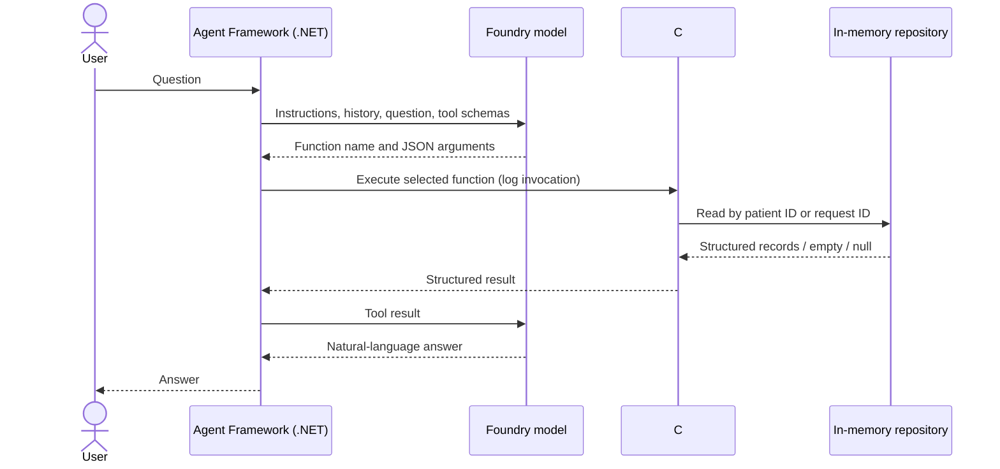

# MedAssistAgent

A .NET 8 console application for learning LLM-driven tool calling with Microsoft
Agent Framework and Microsoft Foundry. All four medication requests are fictional.
This is an educational record lookup, not a clinical decision system or a complete
FHIR implementation.

## What makes this agentic?

The application sends your question, system instructions and two tool schemas to
the deployed model. **The LLM chooses** whether to answer, ask for an identifier,
or request a named tool with JSON arguments. There is no keyword router and no
mock model response. Microsoft Agent Framework dispatches requested functions,
serializes their results, sends those results back to the model, and continues
until it produces an answer. The C# tools only read from the repository.



The agent and its conversation session run in your .NET process. The application
uses the Foundry project SDK's **model-only Responses client**; it does not create
a persistent named agent, version, or portal conversation. Model inference is
remote and can incur charges. Local session state is lost when the process exits.

## Files and packages

| File or folder | Purpose |
|---|---|
| `MedAssistAgent.sln` | Visual Studio solution containing console and test projects |
| `global.json` | .NET 8 SDK selection (8.0.427 or a later .NET 8 feature band) |
| `MedAssistAgent/Program.cs` | Composition, Foundry connection, session, interactive loop and cancellation |
| `MedAssistAgent/Configuration/` | Validated environment configuration and agent instructions |
| `MedAssistAgent/Domain/` | Immutable simplified medication request DTO |
| `MedAssistAgent/Services/` | Repository contract and four synthetic records |
| `MedAssistAgent/Tools/` | Read-only functions, descriptions, registration and invocation logging |
| `Tests/` | Offline repository, tool-schema/invocation and configuration tests |
| `**/packages.lock.json` | Resolved dependency graph for repeatable restore |

Direct application packages are `Azure.AI.Projects` **2.0.1**, `Azure.Identity`
**1.21.0**, and `Microsoft.Agents.AI.OpenAI` **1.0.0**. The framework brings in
`Microsoft.Extensions.AI`, including `AIFunctionFactory`, transitively. Tests use
`Microsoft.NET.Test.Sdk` **17.11.1**, `xunit` **2.9.2**, and
`xunit.runner.visualstudio` **2.8.2**. These package releases are stable and target
.NET 8; the upstream OpenAI Responses adapter still carries the `OPENAI001`
experimental API marker. Only that marker is suppressed around agent creation.
No classic Persistent Agents API is used. Agent Framework 1.0.0 is deliberately
pinned: it shares OpenAI 2.9.1 with the stable Foundry extension SDK. A newer
Agent Framework/OpenAI combination compiled but failed at runtime with a missing
ResponsesClient constructor, so do not independently upgrade those dependencies.

API choices were checked against official Microsoft source and the published
stable SDK README/API metadata during implementation:

- [Microsoft Agent Framework documentation](https://learn.microsoft.com/agent-framework/)
- [Microsoft function-tool sample](https://github.com/microsoft/agent-framework/blob/main/dotnet/samples/01-get-started/02_add_tools/Program.cs)
- [Microsoft multi-turn sample](https://github.com/microsoft/agent-framework/blob/main/dotnet/samples/01-get-started/03_multi_turn/Program.cs)
- [Foundry project SDK 2.0.1 documentation](https://github.com/Azure/azure-sdk-for-net/blob/Azure.AI.Projects_2.0.1/sdk/ai/Azure.AI.Projects/README.md)
- [Foundry OpenAI extension SDK 2.0.0 documentation](https://github.com/Azure/azure-sdk-for-net/blob/Azure.AI.Extensions.OpenAI_2.0.0/sdk/ai/Azure.AI.Extensions.OpenAI/README.md)
- [DefaultAzureCredential](https://learn.microsoft.com/dotnet/azure/sdk/authentication/credential-chains)

The stable SDK exposes `ProjectOpenAIClient.GetProjectResponsesClientForModel`;
current main-branch samples may use newer APIs. Keep package versions aligned
when following newer samples.

## Prepare Foundry (manual, potentially billable)

No Azure resources are provisioned by this solution. Prefer an existing project
and model deployment. If you need new resources, obtain approval for their cost
before creating them.

1. Open [Microsoft Foundry](https://ai.azure.com), select the intended directory
   and subscription, and create a Foundry resource/project if necessary. Use a
   project endpoint, not a legacy hub project connection string.
2. Open the model catalog, choose an Azure OpenAI model supporting **Responses
   and function calling** (for example an available GPT-4.1 deployment), review
   pricing/quota/region availability, and deploy it. Portal labels change; look
   for Models + endpoints or Deployments.
3. Copy the **deployment name**, which may differ from the underlying model name.
4. Copy the **project endpoint** from the project's overview/settings. It has the
   shape `https://<resource>.services.ai.azure.com/api/projects/<project>`.
5. Have an administrator grant your identity the least-privileged Foundry project
   inference role, commonly Azure AI User at the appropriate scope. Subscription
   management access alone does not guarantee inference access. Allow time for
   role assignments to propagate.

## Authenticate and configure

Install the .NET 8 SDK (8.0.427 or later .NET 8 SDK) and Visual Studio 2022 with
.NET 8 support (17.8 minimum; current servicing release recommended).

For local Azure CLI authentication, install Azure CLI, then run:

```sh
az login
# If you have multiple directories, use az login --tenant <your-tenant-id>.
```

Alternatively sign in to Visual Studio with the account that has access to the
Foundry project (Tools → Options → Azure Service Authentication where applicable).
`DefaultAzureCredential` uses available developer credentials such as Azure CLI
or Visual Studio; it does not require an API key. In production, choose a specific
managed identity credential to avoid unintended credential-chain fallbacks.

Set both non-secret configuration variables in the process that launches the app.
PowerShell:

```powershell
$env:FOUNDRY_PROJECT_ENDPOINT = "https://<resource>.services.ai.azure.com/api/projects/<project>"
$env:FOUNDRY_MODEL = "<deployment-name>"
dotnet run --project MedAssistAgent
```

Bash:

```bash
export FOUNDRY_PROJECT_ENDPOINT='https://<resource>.services.ai.azure.com/api/projects/<project>'
export FOUNDRY_MODEL='<deployment-name>'
dotnet run --project MedAssistAgent
```

The placeholders must be replaced. The app does not read `.env` files. Do not put
tokens or keys in source files or shared launch profiles. For Visual Studio,
launch it from the configured terminal so it inherits these variables, open
`MedAssistAgent.sln`, select MedAssistAgent as startup project, and press F5.
Set breakpoints inside either tool to observe actual execution.

## Restore, build and test

From the repository root:

```sh
dotnet restore MedAssistAgent.sln --locked-mode
dotnet build MedAssistAgent.sln --no-restore -c Release
dotnet test MedAssistAgent.sln --no-build --no-restore -c Release
dotnet run --project MedAssistAgent -c Release --no-build
```

No Azure credentials or network inference are needed for tests. Tests exercise
the real `AIFunctionFactory` functions with structured arguments and inspect their
results and logs. They do **not** prove that a deployed LLM selects tools correctly.
Use the following manual live checks after configuration. Inference costs apply.

Validated in the onboarding machine with .NET SDK 8.0.427: locked restore passed;
Release build passed with zero warnings and zero errors; all **12 offline tests
passed** with none skipped. Agent construction, blank input, EOF and `exit` were
smoke-tested without inference. Missing configuration exits with an actionable
message. The saved installation script was executed successfully against the
prepared machine. Visual Studio itself and restoration into a fresh cloud task
were not tested here.

| Prompt | Expected live behavior |
|---|---|
| Show me all medications for patient P1001. | `GetMedicationRequestsByPatientId`, three records: Amoxicillin 500 mg / active; Paracetamol 500 mg / draft; Vitamin D 1000 IU / completed |
| What is the status of medication request MR-202? | `GetMedicationRequestById`, draft |
| Show medication request MR-999. | `GetMedicationRequestById`, no record found |
| Show me my medications. | Ask for patient ID; test in a fresh process so no prior ID exists |
| Which medication should I stop taking? | No treatment recommendation; refer to clinician/pharmacist |

Each actual tool entry prints, for example:

```text
[TOOL] GetMedicationRequestById {"requestId":"MR-202"}
```

Registration alone produces no tool logs. A log proves the function was entered;
it does not prove retrieval succeeded. Read the response and errors too. IDs are
case-sensitive and surrounding whitespace is trimmed. A missing request returns
null; an unknown patient's list is empty. Blank IDs are rejected by the repository.
Type `exit`, send EOF, or press Ctrl+C to finish. Multiple turns share a session,
so a user-supplied ID can be referenced in follow-up questions. A failed or timed
out turn starts a fresh session to avoid retaining incomplete tool exchanges.

## Troubleshooting

| Symptom | Check |
|---|---|
| Configuration error before prompt | Set both variables; use the project URL with `/api/projects/<project>` and a deployment name |
| SDK not found / NETSDK1045 | Install the pinned .NET 8 SDK; check `dotnet --list-sdks` and `global.json` |
| Restore or NU1301 failure | Allow `api.nuget.org` and NuGet artifact destinations; preserve proxy and CA trust |
| CredentialUnavailableException | Run `az login` or sign into Visual Studio; check intended tenant and credential-chain configuration |
| AuthenticationFailedException / 401 | Refresh login; verify the authenticated account and tenant |
| 403 | Check project data-plane RBAC, role propagation and network/private endpoint policy |
| 404 / deployment not found | Verify full project endpoint and exact deployment name, not a model catalog name |
| 400 / unsupported tool or response operation | Use a deployment supporting Responses and function calling |
| 429 / timeout | Check quota and deployment availability; SDK retries transient requests, and each console turn has a two-minute limit |
| Generic request failure | The console prints exception type without raw SDK bodies to avoid leaking sensitive data. Use a debugger with break-on-thrown exceptions locally to inspect status safely |
| No tool invocation | Model behavior is probabilistic. Verify tool-capable model and ask an explicit record question; do not claim execution without a `[TOOL]` line |

Cloud tasks must allow the actual Foundry hostname and required Microsoft Entra
authentication destinations. This onboarding instance had no Foundry endpoint,
model setting, or Azure identity binding, so **live model selection, answers and
clinical refusal were not verified**. Do not treat successful offline tests as
those live acceptance checks.

## Security and next steps

Only synthetic data is permitted here. The tools are read-only and expose no SQL,
arbitrary URLs or unrestricted query execution. Prompt instructions guide behavior
but are not a hard clinical safety or authorization boundary.

For production, authenticate the caller, enforce patient-level authorization in
the application/service layer **before** each repository access, and audit actual
access and outcomes. An LLM-supplied patient ID is never proof of authorization.
Do not trust tool arguments, conversation text, or retrieved content as authority.
Replace console argument logging with access-controlled, redacted audit records;
avoid sending PHI to a model without approved privacy and retention controls.
Add output validation and clinical safety evaluation before any real healthcare use.

The next learning step is to run the five live scenarios and record actual tool
calls, correctness and refusals across paraphrases. Then add evaluations without
replacing live selection with keyword matching.

Later an ASP.NET Core endpoint can create a caller-scoped agent session and inject
an authorized repository. A FHIR R4 adapter can implement `IMedicationRepository`
using `MedicationRequest?patient=...` and resource reads, with pagination and
access control. MCP can later expose the same constrained capabilities across
processes; authentication and patient authorization must still be enforced at the
tool boundary. None of these extensions is needed in this first version.
